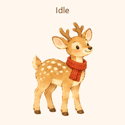

# 未来 · Mirai

未来是一只戴着暖砖红围巾的水彩小鹿，有九种动作和十六个视线方向。

## 在 ChatGPT 工作模式领养

1. 登录 ChatGPT，打开 [领养「未来」](https://chatgpt.com/s/sharepet_6af56f99fb688191988671ecbea2b7c2)。
2. 按页面提示领养。进入 ChatGPT 工作模式后，在宠物选择界面选中「未来」。

## 素材

- [宠物图集](mirai-spritesheet.png) 是透明 PNG，尺寸为 1536 × 2288，采用 Pets v2 格式，已通过 Pets 校验。
- [动作一览](mirai-contact.png) 和 [视线一览](mirai-directions.png) 可查看每帧的姿态。
- [MP4 预览](mirai-preview.mp4)、[跳跃循环](mirai-jump.gif) 和 [视线循环](mirai-look.gif) 可单独播放。
- [基础形象](mirai-base.png) 使用洋红色制作底色。成品图集是透明背景。
